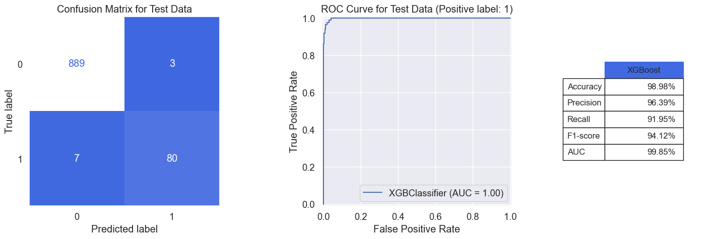
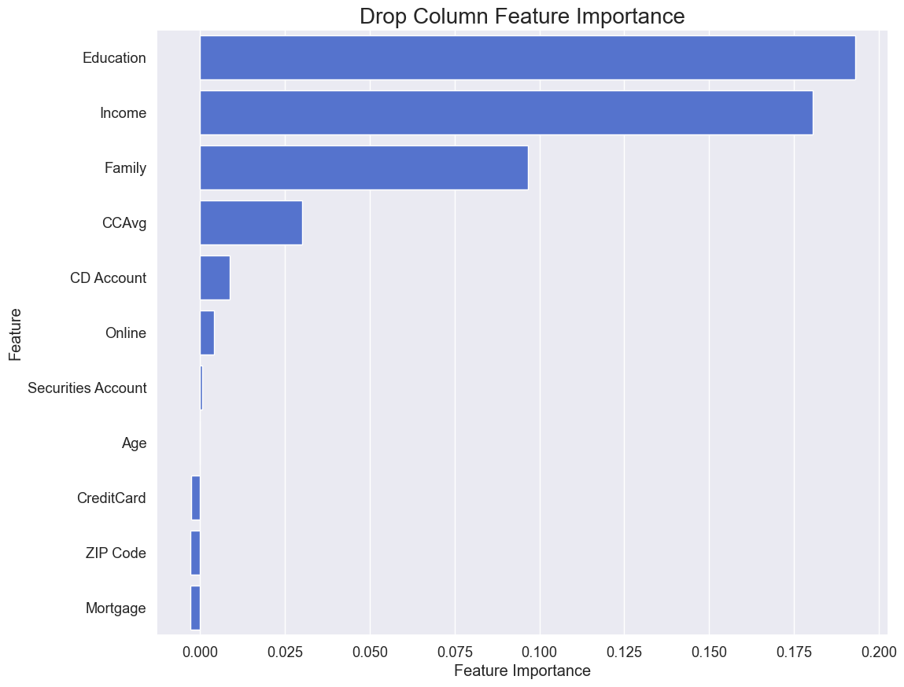

# Bank Personal Loan Classifier

Which bank customers will accept a personal loan offer? Only about 9% do, so this
is an imbalanced binary classification problem. The notebook compares two Naive
Bayes variants, an elastic-net logistic regression and XGBoost, with feature
selection driven by drop-column importance and model selection driven by F1 on
the minority class.


## Results

Held-out test set: 979 customers (87 positives), stratified 80/20 split.
Metrics are for the positive class (loan accepted).

| Model | Accuracy | Precision | Recall | F1 | ROC AUC |
|---|---:|---:|---:|---:|---:|
| **XGBoost** | **98.98%** | **96.39%** | 91.95% | **94.12%** | **99.85%** |
| Logistic Regression (elastic net) | 94.79% | 72.50% | 66.67% | 69.46% | 95.96% |
| Bernoulli Naive Bayes | 93.87% | 72.13% | 50.57% | 59.46% | 94.51% |
| Complement Naive Bayes | 86.01% | 38.32% | **94.25%** | 54.49% | 93.27% |

XGBoost misclassifies 10 of 979 test customers (7 missed acceptors, 3 false
alarms). Complement NB has the highest recall but flags many non-acceptors,
which makes it a reasonable choice only if missing a likely customer costs far
more than contacting an uninterested one.

<p align="center">
  
</p>

## What drives acceptance

Drop-column importance (the F1 lost when a feature is removed and the model is
refit under 5-fold CV) for XGBoost:

<p align="center">
  
</p>

Education, income and family size dominate; credit-card spending (`CCAvg`) and
holding a CD account add a little more. Age, mortgage, ZIP code and credit-card
ownership contribute nothing once the others are known.

A t-SNE projection of the standardised features shows that acceptors cluster in
a few distinct regions rather than spreading across the customer base:

<p align="center">
  
</p>

## Pipeline

1. **Cleaning**: negative `Experience` values (52 rows) made absolute; 105 mortgage outliers (z > 3) and one invalid ZIP code removed; `Experience` dropped as redundant with `Age` (Spearman ρ ≈ 0.99).
2. **Naive Bayes models**: continuous features discretised with `KBinsDiscretizer`; bin count and strategy chosen by grid search, then one-hot encoded.
3. **Logistic regression**: standardised features; grid search over solver, penalty (none / L1 / L2 / elastic net), `C` and class weights.
4. **XGBoost**: features with drop-column importance below 0.002 removed, then refit with `max_depth = 4` and `scale_pos_weight = 1.5`.
5. **Selection metric**: F1 on the positive class, using stratified 5-fold CV throughout.

## Running it

```bash
pip install -r requirements.txt
jupyter notebook imbalanced-personal-bank-loan-classification.ipynb
```

The dataset (`Bank_Personal_Loan_Modelling.xlsx`, 5,000 customers, 14 columns)
is included in the repository.

## Project structure

```
├── imbalanced-personal-bank-loan-classification.ipynb   # full analysis (comments in Korean)
├── Bank_Personal_Loan_Modelling.xlsx                    # dataset
├── results/                                             # figures exported from the notebook
└── requirements.txt
```

## Context

Final project for an AI course at Seoul National University (2025).

## License

Code is released under the [MIT License](LICENSE). The dataset is a widely used
public teaching dataset and remains subject to its original terms.
